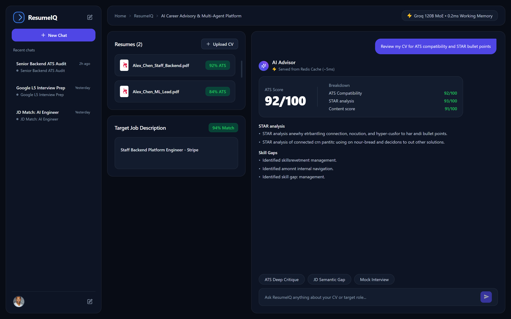
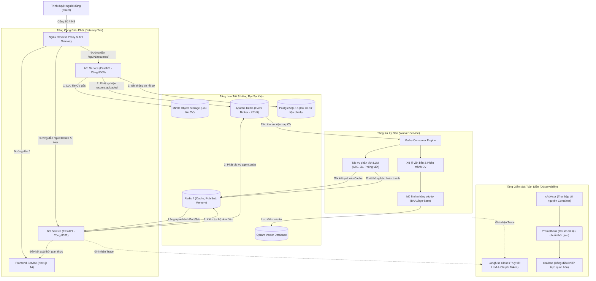

# ResumeIQ - Nền Tảng AI Tư Vấn Nghề Nghiệp Và Phân Tích CV Chuyên Sâu

[](https://nextjs.org/)
[](https://fastapi.tiangolo.com/)
[](https://www.python.org/)
[](https://kafka.apache.org/)
[](https://redis.io/)
[](https://www.postgresql.org/)
[](https://qdrant.tech/)
[](https://min.io/)
[](https://nginx.org/)
[](https://www.docker.com/)
[](https://prometheus.io/)
[](https://grafana.com/)

ResumeIQ là hệ thống ứng dụng trí tuệ nhân tạo toàn diện hỗ trợ ứng viên ngành Công nghệ Thông tin (IT) và Trí tuệ Nhân tạo (AI) phân tích hồ sơ ứng tuyển (CV), chấm điểm độ tương thích theo tiêu chuẩn hệ thống tuyển dụng tự động (ATS), đối chiếu mức độ phù hợp với bản mô tả công việc (Job Description), nhận diện lỗ hổng kỹ năng và luyện tập phỏng vấn kỹ thuật theo thời gian thực.

Hệ thống được phát triển theo mô hình kiến trúc hướng sự kiện (Event-Driven Microservices), kết hợp cơ chế Đa tác tử (Multi-Agent), cơ sở dữ liệu véc-tơ (Vector Database) và cơ chế bộ nhớ đệm phân tán hiệu năng cao.



---

## Chi Tiết Công Nghệ Sử Dụng (Tech Stack)

### 1. Giao Diện & Trải Nghiệm Người Dùng (Frontend)
- **Khung ứng dụng:** Next.js 14 (App Router), React 18, TypeScript.
- **Tạo kiểu & Giao diện:** Tailwind CSS, PostCSS, Lucide React (Bộ icon tối giản).
- **Giao tiếp thời gian thực:** WebSockets API nguyên bản hỗ trợ luồng truyền phản hồi (Streaming Token) hai chiều liên tục.
- **Quản lý trạng thái:** React Hooks (useState, useEffect, useRef, useCallback) xử lý phân luồng tin nhắn và trạng thái tải dữ liệu.

### 2. Dịch Vụ Máy Chủ & Xử Lý Bất Đồng Bộ (Backend & Microservices)
- **Ngôn ngữ & Môi trường:** Python 3.11.
- **Web Framework:** FastAPI (Asynchronous Server Gateway Interface - ASGI) chạy trên nền Uvicorn.
- **Xác thực & Ràng buộc dữ liệu:** Pydantic v2 (Strict Schema Validation).
- **Truy cập cơ sở dữ liệu:** SQLAlchemy 2.0 (chế độ Async ORM) kết hợp trình điều khiển Asyncpg hiệu năng cao.
- **Xử lý tệp tin:** PyPDF, python-docx phục vụ trích xuất và bóc tách văn bản thô từ tài liệu ứng viên.

### 3. Trí Tuệ Nhân Tạo & Khung RAG (AI & LLM Pipeline)
- **Mô hình suy luận lớn (LLM):** Groq Cloud API (Llama 3.3 70B Versatile, Mixtral 8x22B) cung cấp tốc độ suy luận siêu tốc (trên 250 tokens/giây).
- **Điều phối chuỗi logic:** LangChain Core, LangChain Community.
- **Mô hình nhúng ngữ nghĩa (Embedding):** `BAAI/bge-base-en-v1.5` (768 chiều véc-tơ, chạy qua HuggingFace Sentence-Transformers).
- **Công cụ tìm kiếm bên ngoài:** Tavily Search API (hỗ trợ tác tử truy vấn dữ liệu việc làm thực tế theo thời gian thực).

### 4. Hệ Thống Dữ Liệu & Lưu Trữ Phân Tán (Databases & Storage)
- **Cơ sở dữ liệu quan hệ:** PostgreSQL 16 (Lưu trữ người dùng, thông tin hồ sơ, lịch sử hội thoại đầy đủ và kết quả đánh giá).
- **Cơ sở dữ liệu véc-tơ:** Qdrant (Lưu trữ điểm nhúng tài liệu CV, thuật toán chỉ mục HNSW, khoảng cách Cosine Similarity phục vụ tìm kiếm ngữ nghĩa).
- **Lưu trữ đối tượng (Object Storage):** MinIO (Chuẩn tương thích AWS S3, triển khai Claim-Check Pattern để lưu trữ file PDF/DOCX nguyên bản an toàn).

### 5. Hàng Đợi Thông Điệp & Bộ Nhớ Đệm Tốc Độ Cao (Messaging & Caching)
- **Message Broker:** Apache Kafka (Chạy ở chế độ KRaft không phụ thuộc ZooKeeper), giao tiếp bất đồng bộ qua thư viện `aiokafka`.
  - Topic `resume.uploaded`: Tiếp nhận sự kiện nạp tài liệu từ API Gateway.
  - Topic `agent.tasks`: Điều phối các tác vụ phân tích nặng (ATS, JD Matching, Mock Interview) sang Worker Pool.
- **Bộ nhớ đệm & Kênh phân phối:** Redis 7 (Alpine Linux).
  - Fast-Path Cache: Lưu trữ kết quả phân tích nặng được mã hóa SHA-256 (TTL 7 ngày), phản hồi trong 5ms.
  - Working Memory: Cửa sổ trượt lưu giữ 6 lượt tương tác gần nhất của từng phiên trò chuyện.
  - Redis Pub/Sub: Cầu nối thời gian thực chuyển giao kết quả phân tích từ Worker về Bot Service.

### 6. Cổng Kết Nối & Bảo Mật (API Gateway & Security)
- **Reverse Proxy:** Nginx (Alpine Linux) với cơ chế cân bằng tải `least_conn` và kết nối thường trực `keepalive 32`.
- **Bộ nhớ đệm biên (Edge Caching):** `proxy_cache` lưu trữ các tài nguyên tĩnh `/_next/static/` với tiêu đề immutable trong 1 năm.
- **Lá chắn bảo mật:** Ẩn định danh máy chủ (`server_tokens off`), bộ tiêu đề phòng thủ OWASP (X-Frame-Options, X-Content-Type-Options, X-XSS-Protection, Referrer-Policy), giới hạn tải lên tối đa 25MB và thuật toán Rate Limiting (20 req/s, burst 10) chống DDoS.
- **Tối ưu băng thông:** Nén Gzip đa định dạng (text, css, js, json, xml) với mức nén 6 giúp giảm 70% dung lượng truyền tải mạng.

### 7. Hệ Thống Giám Sát Toàn Diện (Observability)
- **Giám sát mô hình AI:** Langfuse Cloud (Theo dõi từng lượt suy luận, chi phí token quy đổi USD, độ trễ và dấu vết chuỗi gọi RAG).
- **Thu thập tài nguyên hệ thống:** Google cAdvisor (Đo lường mức tiêu thụ CPU, RAM, I/O đĩa và băng thông của từng container Docker).
- **Lưu trữ dữ liệu giám sát:** Prometheus (Chu kỳ thu thập số liệu 5 giây/lần).
- **Trực quan hóa bảng điều khiển:** Grafana (Bảng hiển thị trạng thái tài nguyên, biểu đồ theo thời gian thực và cảnh báo hiệu năng).

### 8. Đóng Gói & Môi Trường Vận Hành (DevOps)
- **Containerization:** Docker 26+, Docker Compose v2.
- **Tối ưu hóa Dockerfile:** Kỹ thuật Multi-stage build kết hợp ảnh nền Alpine Linux, dọn dẹp bộ nhớ đệm pip/npm giúp giảm dung lượng image tối đa.
- **Mạng nội bộ:** Docker Bridge Network (`resumeiq-network`) cô lập toàn bộ các kết nối nội bộ giữa 12 container.

---

## 1. Giới Thiệu Dự Án

Trong quy trình tuyển dụng tại các tập đoàn công nghệ hiện nay, phần lớn hồ sơ ứng viên bị sàng lọc tự động bởi các phần mềm ATS trước khi đến tay bộ phận nhân sự. Ứng viên thường gặp các vấn đề lớn:
- Trình bày CV không tương thích với bộ bóc tách văn bản của ATS.
- Thiếu các số liệu đo lường định lượng và chưa diễn đạt kinh nghiệm theo mô hình chuẩn STAR (Situation, Task, Action, Result).
- Thiếu các từ khóa chuyên môn cốt lõi mà bản mô tả công việc (Job Description) yêu cầu.
- Thiếu sự chuẩn bị cho các câu hỏi phỏng vấn kỹ thuật bám sát kinh nghiệm thực tế.

ResumeIQ được xây dựng nhằm giải quyết triệt để các rào cản trên bằng cách tự động hóa quy trình phân tích, lượng hóa điểm số và đồng hành cùng ứng viên trong suốt quá trình chuẩn bị hồ sơ ứng tuyển.

---

## 2. Các Tính Năng Cốt Lõi

### Phân tích hồ sơ và chấm điểm ATS
- Đánh giá chỉ số tương thích ATS trên thang điểm 100.
- Đo lường mức độ định lượng kết quả và kiểm tra cấu trúc diễn đạt theo tiêu chuẩn STAR.
- Chỉ ra cụ thể các điểm mạnh, điểm yếu chí mạng và đưa ra phương án chỉnh sửa chi tiết cho từng dòng kinh nghiệm trong CV.

### Đối chiếu CV với mô tả công việc (JD Matching)
- So khớp ngữ nghĩa giữa năng lực ứng viên và yêu cầu tuyển dụng của doanh nghiệp.
- Phân loại mức độ phù hợp theo 4 cấp độ: Phù hợp cao (Strong Match), Phù hợp trung bình (Moderate Match), Có tiềm năng (Potential Match) và Phù hợp thấp (Low Match).
- Liệt kê danh sách các kỹ năng bắt buộc còn thiếu (Critical Missing Skills) để ứng viên bổ sung kịp thời.

### Trợ lý tư vấn nghề nghiệp thời gian thực (Real-Time AI Copilot)
- Tương tác hai chiều mượt mà với ứng viên thông qua kết nối WebSocket.
- Tư vấn định hướng sự nghiệp, giải đáp các thắc mắc về văn hóa doanh nghiệp và yêu cầu thị trường.
- Cơ chế gọi công cụ thông minh (Tool Calling) cho phép AI truy xuất dữ liệu CV và lịch sử trò chuyện trực tiếp từ cơ sở dữ liệu véc-tơ.

### Luyện tập phỏng vấn kỹ thuật (Mock Interview)
- Tự động sinh ra bộ câu hỏi phỏng vấn tình huống và kỹ thuật chuyên sâu dựa trên dự án thực tế trong CV của ứng viên.
- Đưa ra khung câu trả lời mẫu theo tiêu chuẩn đánh giá của các giám khảo kỹ thuật.

### Tối ưu phản hồi với Fast-Path Caching (Redis)
- Toàn bộ kết quả phân tích nặng (ATS Critique, JD Matching, Mock Interview) được băm khóa xác thực (SHA-256) và lưu trữ trong Redis trong 7 ngày.
- Khi nhận yêu cầu giống nhau, hệ thống lập tức trả kết quả trong khoảng 5ms, giảm thiểu 100% chi phí token và giải phóng tài nguyên tính toán của mô hình ngôn ngữ lớn (LLM).

---

## 3. Kiến Trúc Hệ Thống

Dự án được thiết kế theo kiến trúc Event-Driven Microservices kết hợp tầng lưu trữ phân tán và cổng API Gateway tập trung.



---

## 4. Luồng Xử Lý Dữ Liệu (Data Flow)

### Luồng nạp và xử lý hồ sơ (Resume Ingestion Flow)
1. Người dùng tải file CV (PDF hoặc DOCX) lên hệ thống từ giao diện web.
2. Yêu cầu đi qua Nginx chuyển tiếp tới **API Service**.
3. **API Service** áp dụng cơ chế Claim-Check Pattern: Tải trực tiếp file nguyên bản lên **MinIO Storage**, ghi nhận thông tin bản ghi vào **PostgreSQL**, sau đó bắn một sự kiện chứa đường dẫn file vào Kafka topic `resume.uploaded`.
4. **Worker Service** nhận sự kiện từ Kafka, tải file từ MinIO về để bóc tách nội dung, trích xuất cấu trúc văn bản, chia đoạn (chunking), chạy mô hình `BAAI/bge-base-en-v1.5` để chuyển đổi sang véc-tơ 768 chiều và lưu vào **Qdrant**.

### Luồng phân tích chuyên sâu & Fast-Path Caching
1. Khi người dùng bấm yêu cầu phân tích ATS hoặc so khớp JD, yêu cầu được gửi tới **Bot Service**.
2. **Bot Service** tính toán mã băm SHA-256 dựa trên định danh CV, nội dung JD và loại tác vụ, sau đó tra cứu trong **Redis Cache**.
3. Nếu dữ liệu đã tồn tại (Cache Hit), kết quả được trả về ngay lập tức cho người dùng (khoảng 5ms).
4. Nếu chưa tồn tại (Cache Miss), **Bot Service** đóng gói tác vụ và gửi vào Kafka topic `agent.tasks`.
5. **Worker Service** tiêu thụ tác vụ, gọi mô hình ngôn ngữ lớn (Groq LLM) để phân tích theo cấu trúc định sẵn (Pydantic Schema), ghi kết quả vào Redis Cache với thời gian sống (TTL) 7 ngày, đồng thời phát thông báo vào kênh Redis Pub/Sub.
6. **Bot Service** nhận được kết quả từ kênh Pub/Sub và chuyển tiếp ngay tới trình duyệt thông qua WebSocket.

---

## 5. Chi Tiết Các Dịch Vụ Thành Phần

### Nginx Reverse Proxy (Cổng 80)
- Đóng vai trò là cổng tiếp nhận duy nhất cho toàn bộ hệ thống.
- Cấu hình định tuyến thông minh:
  - `/` dẫn tới giao diện người dùng Frontend (Next.js).
  - `/api/v1/resumes/` dẫn tới dịch vụ nghiệp vụ API Service.
  - `/api/v1/chat/` và `/ws/` dẫn tới dịch vụ Bot Service cùng tiêu đề nâng cấp WebSocket.
  - `/_next/static/` được lưu đệm tĩnh tại máy chủ biên Nginx giúp giảm tải cho dịch vụ Frontend.
- Thiết lập bảo mật chuẩn công nghiệp: Ẩn phiên bản máy chủ (`server_tokens off`), bổ sung các tiêu đề bảo vệ HTTP chuẩn OWASP, giới hạn kích thước tải tệp tối đa 25MB và áp dụng thuật toán giới hạn tần suất truy cập (Rate Limiting) 20 yêu cầu/giây để ngăn chặn tấn công từ chối dịch vụ (DDoS).
- Nén luồng dữ liệu truyền tải bằng Gzip giúp tiết kiệm băng thông mạng.

### Frontend Service (Next.js 14)
- Xây dựng trên nền tảng Next.js App Router kết hợp Tailwind CSS.
- Thiết kế giao diện 3 cột khoa học và trực quan:
  - Cột bên trái: Danh sách các phiên trò chuyện trong quá khứ, nút tạo hội thoại mới và nút dọn dẹp lịch sử.
  - Cột ở giữa: Danh mục các hồ sơ đã tải lên, hiển thị điểm ATS vắn tắt và khung nhập bản mô tả công việc mục tiêu.
  - Cột bên phải: Cửa sổ đối thoại trực tiếp với trợ lý AI qua WebSocket, thẻ điểm ATS chi tiết, đánh giá cấu trúc STAR và huy hiệu thông báo kết quả trả về từ bộ nhớ đệm (Cache Hit).

### API Service (FastAPI - Cổng 8000)
- Cung cấp các điểm cuối RESTful API phục vụ quản lý vòng đời của hồ sơ người dùng.
- Tích hợp trực tiếp với MinIO Client và Kafka Producer.
- Đảm bảo an toàn dữ liệu và tính toàn vẹn của hồ sơ ứng viên.

### Bot Service (FastAPI - Cổng 8001)
- Tiếp nhận và duy trì kết nối WebSocket thời gian thực cho từng người dùng.
- Đóng vai trò là bộ điều phối tác vụ thông minh (Task Dispatcher): Tự động phân loại câu hỏi thông thường để trả lời ngay lập tức qua kỹ thuật Fast-Path RAG, hoặc chuyển các tác vụ phân tích nặng về hàng đợi Kafka.
- Quản lý bộ nhớ ngữ cảnh ngắn hạn (Working Memory) gồm 6 lượt hội thoại gần nhất trong Redis và lưu trữ toàn bộ lịch sử trao đổi vào PostgreSQL.

### Worker Service (Python Async Engine)
- Dịch vụ xử lý nền chạy ngầm độc lập, giao tiếp thông qua Kafka Consumer Group.
- Quản lý 2 tiến trình xử lý song song:
  - Tiến trình 1: Tiếp nhận tệp tin, trích xuất dữ liệu thô, phân đoạn và tạo chỉ mục véc-tơ vào Qdrant.
  - Tiến trình 2: Xử lý các tác vụ phân tích chuyên sâu sử dụng mô hình ngôn ngữ lớn (LLM), ép kiểu dữ liệu đầu ra nghiêm ngặt theo chuẩn Pydantic, ghi dữ liệu vào Redis Cache và kích hoạt sự kiện trên Redis Pub/Sub.

---

## 6. Giải Pháp Giám Sát Hệ Thống (Observability)

Dự án áp dụng mô hình giám sát 2 tầng độc lập nhằm đảm bảo hệ thống vận hành liên tục và ổn định:

### Tầng 1: Giám sát chuyên sâu mô hình AI (Langfuse Cloud)
- Gắn bộ theo dõi CallbackHandler vào toàn bộ các tiến trình gọi mô hình ngôn ngữ lớn trong hệ thống.
- Theo dõi định lượng: Tổng số token đầu vào (prompt tokens), token đầu ra (completion tokens), thời gian phản hồi (latency) và chi phí ước tính theo từng phiên làm việc.
- Hỗ trợ xem lại chi tiết chuỗi suy luận (trace log) để tinh chỉnh lời nhắc (prompt engineering) và phát hiện lỗi ngữ nghĩa.

### Tầng 2: Giám sát tài nguyên máy chủ và container (Prometheus + Grafana + cAdvisor)
- **cAdvisor (Cổng 8080):** Đo lường trực tiếp mức độ tiêu thụ CPU, bộ nhớ RAM, lưu lượng vào/ra mạng và hoạt động đọc/ghi ổ cứng của từng container đang chạy.
- **Prometheus (Cổng 9090):** Thu thập dữ liệu từ cAdvisor theo chu kỳ 5 giây một lần và lưu trữ vào cơ sở dữ liệu chuỗi thời gian.
- **Grafana (Cổng 3001):** Hiển thị các biểu đồ trực quan, hỗ trợ theo dõi hiệu năng hệ thống theo thời gian thực và cấu hình cảnh báo quá tải tài nguyên.

---

## 7. Hướng Dẫn Cài Đặt Và Khởi Chạy

### Yêu cầu môi trường
- Máy tính hoặc máy chủ đã cài đặt Docker và Docker Compose (Docker Desktop đối với Windows/macOS hoặc Docker Engine đối với Linux).
- Dung lượng RAM tối thiểu: 8GB (khuyến nghị 16GB để các dịch vụ AI và cơ sở dữ liệu hoạt động tối ưu).

### Bước 1: Thiết lập biến môi trường
Sao chép tệp cấu hình mẫu `.env.example` thành `.env`:

```bash
cp .env.example .env
```

Mở tệp `.env` và cung cấp các khóa xác thực cần thiết:
- `GROQ_API_KEY`: Khóa truy cập dịch vụ mô hình ngôn ngữ lớn từ Groq Cloud Console (console.groq.com).
- `TAVILY_API_KEY`: Khóa truy cập công cụ tìm kiếm dữ liệu tuyển dụng từ Tavily AI (tavily.com).
- `LANGFUSE_PUBLIC_KEY` và `LANGFUSE_SECRET_KEY`: Khóa kết nối giám sát từ Langfuse Cloud (cloud.langfuse.com).

### Bước 2: Khởi động toàn bộ dịch vụ bằng Docker Compose
Thực thi lệnh sau tại thư mục gốc của dự án để hệ thống tự động biên dịch và khởi tạo 12 dịch vụ:

```bash
docker compose up -d --build
```

Kiểm tra danh sách và trạng thái hoạt động của các container:

```bash
docker compose ps
```

### Bước 3: Truy cập hệ thống và bảng điều khiển

Sau khi toàn bộ dịch vụ được khởi chạy thành công, có thể truy cập qua trình duyệt:

- **Giao diện ứng dụng ResumeIQ:** `http://localhost` (Cổng 80 qua Nginx Gateway).
- **Tài liệu API Service (Swagger UI):** `http://localhost:8000/docs`
- **Tài liệu Bot Service (Swagger UI):** `http://localhost:8001/docs`
- **Bảng quản trị MinIO Storage:** `http://localhost:9001` (Tài khoản mặc định: `minioadmin` / `minioadmin_password`).
- **Bảng truy vấn Prometheus:** `http://localhost:9090`
- **Bảng điều khiển giám sát Grafana:** `http://localhost:3001` (Tài khoản mặc định: `admin` / `admin`).
